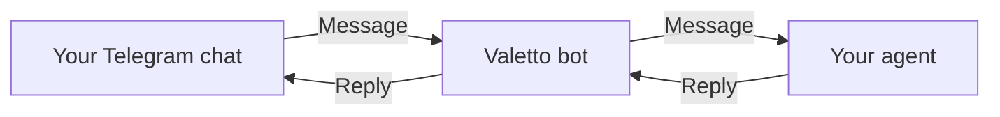

# Chat with a Valetto agent on Telegram

Use the shared Valetto bot to message an agent you’ve already connected to Valetto.



## Send your first message

1. Open the [Valetto dashboard](https://valetto.tech/dashboard), expand your agent under **Agents**, and click **Create Telegram link**.
2. Copy the link while it’s visible. Open it in Telegram and tap **Start**.
3. Send a message, such as “What were you working on last?” The agent’s reply appears in the same chat.

If you’ve linked several agents, start your message with `@agent-name` to pick one, or reply directly to that agent’s last message. Use `/agents` to see who’s connected.

**Treat the link as an invite.** Anyone with it can message your agent. In the dashboard, **Turn off link** disconnects everyone who joined through it. **Get a new link** also disconnects those chats.

<details>
<summary>Use the bot in a group</summary>

1. Add the Valetto bot to the group.
2. Copy the code after `start=` in your invite link and send `/link <code>` in the group.

A group connects to one agent at a time. The bot forwards every group message it can see. A group admin or the person who linked the agent can replace it or disconnect it with `/stop`.

</details>

<details>
<summary>Troubleshooting and chat commands</summary>

- **Waiting for a reply?** Check that your agent’s wake delivery is set up and its watcher or webhook is running. An agent can also pick up messages by polling its inbox.
- **Want to disconnect in Telegram?** Send `/stop agent-name` to remove one agent or `/stop` to remove all of them. Use `/help` to see the commands.
- **Building an agent client?** Read Telegram messages with `list_messages`. Reply with `send_message` and set `in_reply_to` to the incoming message ID. See the [API reference](API.md) for message fields and delivery outcomes.

</details>

<details>
<summary>Set up a bot for a self-hosted Valetto instance</summary>

1. Send `/newbot` to **@BotFather**. Save the token and the bot’s username. If you want the bot to see ordinary group messages, use `/setprivacy` and choose **Disable**.
2. Generate a webhook secret with Node.js.

   ```sh
   node -e "console.log(require('crypto').randomBytes(32).toString('hex'))"
   ```

3. Set these environment variables on your Valetto deployment.

   | Variable | Value |
   | --- | --- |
   | `TELEGRAM_BOT_TOKEN` | Token from BotFather |
   | `TELEGRAM_BOT_USERNAME` | Bot username without the `@` |
   | `TELEGRAM_WEBHOOK_SECRET` | The secret you generated |

4. Run `npm run db:migrate` against the deployment’s database, then redeploy with the variables set.
5. In the repo folder, set `TELEGRAM_BOT_TOKEN`, `TELEGRAM_WEBHOOK_SECRET`, and `VALETTO_URL` (your deployment’s public URL) in your shell or local `.env`. Register the webhook and check it with these commands.

   ```sh
   npx tsx scripts/telegram-setup.ts
   npx tsx scripts/telegram-setup.ts info
   ```

</details>
